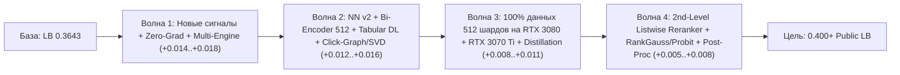
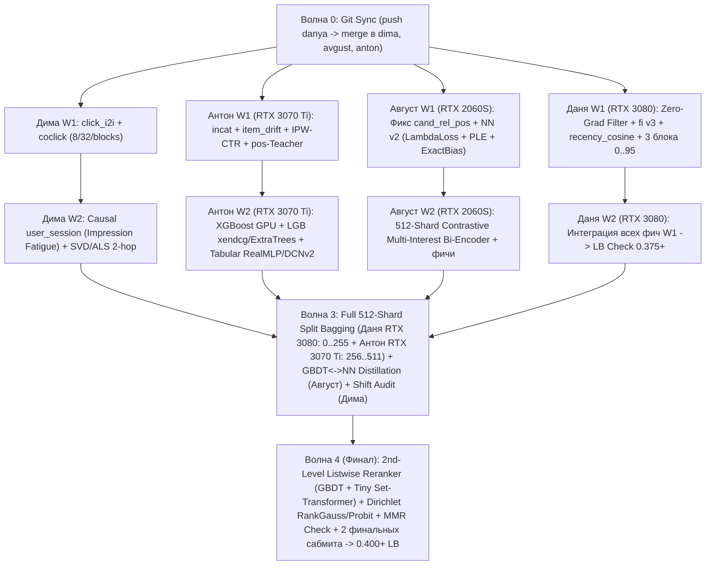

# Генеральный план команды: Avito Ranking Hackathon 2026 — Скоростной выход на `0.400+` Public LB

**Стартовая точка:**
- **Текущий Public LB:** `0.36426` (`blend-oof-v36-cb8wi2i-seeds`, прирост **+0.0021** за один цикл после интеграции `weighted-item2item` + `feed_interactions`).
- **Лучшая одиночная GBDT (4-fold CV):** `cb8-all-wi2i-fi-qsm-cv-s2` — `priv@30 = 0.3103`, `pub@30 = 0.3208` (обучена всего на **8 из 512 шардов = 1.56%** данных!).
- **Лучшая текущая NN (4-fold OOF):** `nn-oof4` — `priv@30 = 0.3007` (обучена всего на **2 из 512 шардов = 0.39%** данных, при этом всё равно забирает 15–20% веса в ансамбле!).
- **Лучший локальный честный ансамбль:** `priv@30 = 0.3128` (`v33b`) / `0.3122` (`v36`).
- **Принцип темпа:** никаких искусственных дат и ожиданий — работаем **параллельными волнами по графу зависимостей**. Как только модуль/модель готовы и прошли проверку — немедленный PR/OOF-пакет, немедленная интеграция в ансамбль и немедленный переход к следующей задаче.

> [!IMPORTANT]
> Главный урок последнего прорыва (`0.3622 → 0.36426`): локальный `pseudo-private NDCG@30` на честном 4-fold OOF (`src.common.cv.time_folds(..., 4)`) надёжно предсказывает рост Public LB, тогда как подгонка весов под `pseudo-public` без усиления базовых моделей ведёт к переобучению. Все решения принимаются строго через **честный 4-fold OOF + парный бутстреп по лентам**, без единого бита утечки из `val`.

---

## 1. Вычислительный кластер команды и разделение ролей

В команде есть **4 рабочие станции и 3 мощные NVIDIA GPU** — это позволяет распараллелить все тяжёлые задачи (512 шардов, три семейства нейросетей, четыре движка GBDT) и сжать сроки выполнения в **2.5–3 раза**.

| Участник | Железо | Агент | Зона ответственности (Ownership) |
|---|---|---|---|
| **Даня** | **RTX 3080 (10 GB VRAM)**, 64 GB RAM, 32 потока CPU | **Gemini 4** | Главный интегратор, Zero-Grad Filtering, `feed_interactions v3`, CatBoost/LGBM бэггинг блоков `0..255`, Cross-Distillation пайплайн, **2nd-Level Listwise Meta-Reranker**, финальные ансамбли и сабмиты |
| **Антон** | **RTX 3070 Ti (8 GB VRAM)** | **GPT Sol 6.2** | Дешифровка `f1..f5` (item drift + `incat_*`), IPW-CTR, **`pos`-Teacher**, **XGBoost GPU** (`rank:ndcg`, `rank:pairwise`), **LightGBM `rank_xendcg` + `extra_trees`**, **Pure Tabular Deep Ranker (`RealMLP/DCNv2`)**, CatBoost GPU альтернативных лоссов + бэггинг блоков `256..511` |
| **Август** | **RTX 2060 SUPER (8 GB VRAM)** | **GPT Sol 6.2** | **Neural Stack v2.0**: фикс `cand_rel_pos` и апгрейд [model.py](file:///c:/dev/avito-hackaton2026/src/nn/model.py) (`LambdaLoss@30` + PLE-эмбеддинги топ-фич + Exact-Match Attention Bias + 3-слойный SwiGLU Set-Transformer + Multi-Task `pos`), **512-Shard Contrastive Multi-Interest Bi-Encoder**, GBDT→NN дистилляция |
| **Дима** | CPU-станция (DuckDB / Polars / строгий аудит) | **GPT Sol 6.2** | **Data & Graph Architect**: Directed `History→Click` & Co-Click Graph (`click_i2i`), Causal Cross-Feed User & Impression Fatigue (`user_session`), **2-Hop Collaborative TruncatedSVD / ALS** по 512 шардам, Adversarial Shift Audit |

---

## 2. Декомпозиция пути `0.3643 → 0.400+` Public LB (`+0.036` NDCG@30)

Почему цель `0.400+` достижима: сейчас мы используем **менее 6% train-данных**, граф `item2item` **вообще не смотрит на клики (`target=1`)**, `user_id` не отслеживает повторные показы между лентами, `f1..f5` не сравниваются с историей самого товара, в `src/nn/dataset.py` обнаружена критическая утечка `cand_rel_pos`, а блендер крутит грубую линейную сетку по 10 моделям только на `pseudo_public`.



### Полный каталог рычагов и ожидаемого вклада

| # | Рычаг | Что упущено сейчас | Конкретное инженерное решение | Оценка (LB) | Владелец |
|---|---|---|---|---|---|
| **1** | **Directed Click-Graph (`click_i2i` + `coclick`)** | [item2item.py](file:///c:/dev/avito-hackaton2026/src/common/item2item.py) считает только co-view в истории, игнорируя **5.3M реальных кликов (`target=1`)** на донорах | Направленный индекс `History(item, evt_type, evt_src) → Clicked Candidate` (Smoothed CTR / Log-Lift / PMI) + Co-Click Graph + Category-Event Backoff (покрытие `10% → 88%`) | `+0.007 .. +0.011` | **Дима** |
| **2** | **Causal User-Session & Impression Fatigue** | `user_id` и `timestamp` между лентами не связаны; показ одного и того же товара юзеру 4-й раз за час не штрафуется | Строго каузальный (`t_prev < t_curr`) трекер повторных показов (`us_item_prior_impr`, `time_since_shown`, `session_depth`, `cat_share_1h`) + донорские кликовые профили `user_id` | `+0.005 .. +0.008` | **Дима** |
| **3** | **2-Hop Collaborative SVD / ALS Embeddings** | Эмбеддинги соревнования — контентные; при отсутствии прямого совпадения пары `(h, c)` граф молчит | Randomized `TruncatedSVD (k=48)` / `Implicit ALS` по разреженной PMI-матрице кликов и истории на донорских шардах → 2-hop коллаборативные косинусы `svd_cos_hist_max/mean` | `+0.003 .. +0.005` | **Дима** |
| **4** | **NN v2.0: Tabular-Fused Set-Transformer** | В [dataset.py](file:///c:/dev/avito-hackaton2026/src/nn/dataset.py) строка 131 подмешивает `cand_rel_pos` (утечка порядка `train`!), обучение шло на **2 шардах**, `ListNet` вместо `NDCG@30`, нет `item_id` bias | Удалить `cand_rel_pos`, `LambdaLoss@30 + Multi-Task pos`, PLE-эмбеддинги топ-80 фич GBDT (внутриленточный RankGauss + DCNv2), Exact-Match & Cosine Attention Bias, 3 слоя SwiGLU Set-Transformer (`d=256`), 64–128 шардов + EMA | `+0.006 .. +0.010` | **Август** |
| **5** | **512-Shard Contrastive Multi-Interest Retriever** | Замороженные `int8` эмбеддинги дают лишь `0.268` и не адаптированы под клик этой ленты | Потоковый Multi-Interest (`K=4`) Bi-Encoder по **всем 512 шардам (247M строк)** с In-Feed Hard Negatives + `pos`-дебиасингом → OOF скор + 6 нейрофич в GBDT | `+0.003 .. +0.006` | **Август** |
| **6** | **Дешифровка `f1..f5` + `incat_*` + IPW-CTR + `pos`-Teacher** | Анонимные `f1..f5` не сравниваются со средней ценой/бустом самого товара; нет конкуренции внутри категории; `pos` из `train` выброшен | `f_k - item_mean_f_k` (дрейф цены/продвижения), ранги внутри `(feed_id, category_id)`, IPW Click-Over-Expected (`COE`), модель `pos`-Teacher (`E[1/log2(pos+2)]`) | `+0.004 .. +0.007` | **Антон** |
| **7** | **Multi-Engine GBDT + Tabular Deep Ranker (RTX 3070 Ti)** | В пуле только CatBoost (`QSM/Yeti`) и LGB (`lambdarank`); нет XGBoost, XENDCG, ExtraTrees и табличной DL-модели | `XGBoost GPU (rank:ndcg, rank:pairwise)`, `LGB rank_xendcg`, `LGB extra_trees`, `Calibrated Binary LogLoss` + **RealMLP/DCNv2 Tabular Listwise Ranker** на RTX 3070 Ti | `+0.005 .. +0.008` | **Антон** |
| **8** | **Zero-Grad Filtering + 100% Data (512 Shards) + `fi v3` + Time-Decay** | Обучение на 8–32 шардах из-за пустых лент; `val_weight` и временной спад не использованы; в [feed_interactions.py](file:///c:/dev/avito-hackaton2026/src/gbdt/feed_interactions.py) нет `wi2i`/`click_i2i` | Отбрасывание `sum(target)==0` на `train` (**−68% RAM и 2.8x быстрее** без потери градиента!), `fi v3`, temporal decay + `--val-weight`, сплит бэггинга **512 шардов** между **RTX 3080 (0..255)** и **RTX 3070 Ti (256..511)** | `+0.006 .. +0.010` | **Даня + Антон** |
| **9** | **Cross-Family Knowledge Distillation (GBDT ↔ NN)** | GBDT и NN учатся изолированно только на жёстких 0/1 метках (2.2% кликов) | Soft listwise-дистилляция OOF-ансамбля GBDT в NN (`KL(softmax(s_GBDT/T))`) + обратная подача OOF-фич NN v2 / Bi-Encoder в 2-е поколение GBDT | `+0.003 .. +0.005` | **Даня + Август** |
| **10** | **2nd-Level Listwise Reranker + RankGauss/Probit + MMR Post-Proc** | [blend.py](file:///c:/dev/avito-hackaton2026/src/ensemble/blend.py) ищет грубую сетку `[0..4]` только на 4328 лентах `pseudo_public` | 4-fold OOF мета-ранкер на всех **14 423 лентах** (GBDT + Tiny 2-слойный Set-Transformer поверх 20+ моделей + `std_z` неопределённости + контекста ленты) + Dirichlet RankGauss/Softmax бэггинг + проверка MMR/дедупликации | `+0.005 .. +0.008` | **Даня** |

---

## 3. Единая инфраструктура, стандарты и защита от багов

### 3.1. Обнаруженные узкие места текущей инфраструктуры (чиним в Волне 1!)
1. **Критический баг в [src/nn/dataset.py](file:///c:/dev/avito-hackaton2026/src/nn/dataset.py#L131):** `cand_rel_pos = np.arange(m) / max(m, 1)` подаётся прямо в числовые фичи кандидата. На `train` порядок кандидатов совпадает с ранжированием боевого рекомендатора, а на `val`/`test` порядок случайный — модель учится полагаться на утечку индекса массива и теряет качество на тесте! **Фикс:** немедленно удалить `cand_rel_pos` и перемешивать порядок кандидатов внутри каждой `train`-ленты на лету (при сохранении привязки `pos` к каждому кандидату для `PosBiasTower`).
2. **Пустые ленты (`Zero-Gradient Feeds`):** около 65–70% лент в `train` не содержат ни одного клика (`sum(target) == 0`). В `QuerySoftMax`, `YetiRank`, `PairLogit`, `LambdaRank`, `rank:ndcg`, `ListNet`, `LambdaLoss` их градиент тождественно равен `0`, но они съедают 2/3 RAM, VRAM и времени! **Фикс:** единый флаг `--drop-zero-grad-feeds` в [run_exp.py](file:///c:/dev/avito-hackaton2026/src/gbdt/run_exp.py) и в PyTorch `Dataset` (строго только на `train`-части, никогда на `val`-оценке и никогда в pointwise binary logloss).
3. **Узкое место CatBoost/LightGBM RAM:** в [models.py](file:///c:/dev/avito-hackaton2026/src/gbdt/models.py#L11) `_x()` конвертирует `Polars -> Pandas`, удваивая пик памяти. Перевод на `Float32 NumPy` / `Arrow` + `--drop-zero-grad-feeds` позволяет учить **128 шардов в одной матрице** на 64 GB RAM (Даня) и **32–64 шарда** на 16–32 GB RAM (Антон).
4. **Несовпадение веток:** `origin/danya` уже содержит смердженный PR #2 от Димы; `origin/avgust` содержит `use_numeric_head` и `train_cv.py`; `origin/anton` отстаёт от `danya`. **Правило старта:** перед Волной 1 Даня пушит `danya` (со всеми общими модулями), остальные делают `git fetch origin && git merge origin/danya` в свои ветки!

### 3.2. «Железный контракт» обмена артефактами (`OOF Package v1` & `Feature Cache`)

- **OOF-пакет (`runs/<model_name>/` — передаётся одним `.zip` ~30 МБ):**
  1. `val_pred.parquet`: ровно **1 389 971 строка**, колонки `feed_id: Int32`, `item_id: Int32`, `target: Int8`, `score: Float32`. Строго **4 временных фолда** через `src.common.cv.time_folds(feed_id, timestamp, 4)`.
  2. `test_pred.parquet`: ровно **2 904 806 строк**, колонки `feed_id: Int32`, `item_id: Int32`, `score: Float32` (среднее `feed_zscore` по 4 фолдам). Обязательный проход:
     ```powershell
     uv run --locked python -u scripts/validate_submission.py competition/sample_submission.parquet runs/<model_name>/test_pred.parquet
     ```
  3. `metrics.json`: параметры запуска, список групп фич, `pub_ndcg@30`, `priv_ndcg@30`, `all_ndcg@30`, SHA-256 паркетов.
- **Кеш признаков (`data/features/<group>/` — передаётся КОДОМ через PR в Git, не пересылаем гигабайты!):**
  - Строится через `src.common.feature_cache.build_cache`, ключ `['split', 'feed_id', 'candidate_index']` + `'item_id'`, сортировка `('feed_id', 'candidate_index')`, все колонки `Float32`, без `NaN`/`Inf`.
  - Все target/pos-зависимые фичи обязаны поддерживать `--train-parts` и `--train-start`, исключать `excluded_train_sources` из доноров и сопровождаться скриптом `scripts/audit_<group>_features.py`.
- **Единый Gate приёмки (`Bootstrap Gate`):**
  ```powershell
  uv run --locked python -u -m scripts.paired_compare --a runs/current_best/val_pred.parquet --b runs/candidate/val_pred.parquet --data competition
  ```

> [!WARNING]
> Абсолютный запрет для всех участников и агентов:
> 1. Никогда не подбирать гиперпараметры, early stopping или веса по `pseudo_private`.
> 2. Никогда не коммитить `runs/`, `data/`, `competition/`, `*.parquet`, `*.zip`, `*.pt`, `*.cbm`.
> 3. Всегда запускать Python строго через `uv run --locked python -u` (у Августа в PyTorch-окружении — его `venv` с CUDA).

---

## 4. Граф параллельных волн выполнения (без дат — максимальная скорость)



### Контрольные вехи качества (без привязки к календарю)

| Веха | Что завершено | Целевой `priv@30` (OOF) | Целевой `Public LB` |
|---|---|---|---|
| **База (Готово)** | `wi2i` + `cb8-wi2i-seeds3` (`0.3103` соло!) + `blend-oof-v36` | `0.3122 – 0.3128` | **`0.36426` (Факт)** |
| **Чекпоинт W1** | Zero-Grad Filter + `fi v3` + 3 блока `0..95` (Даня) + `click_i2i` (Дима) + `incat/drift/pos-Teacher` (Антон) + фикс/старт NN v2 (Август) | `0.320 – 0.325` | **`0.372 – 0.378`** |
| **Чекпоинт W2** | `user_session` + `SVD 2-hop` (Дима) + `NN v2 Set-Ranker` + `Bi-Encoder 512` (Август) + `XGBoost GPU / XENDCG / Tabular DCNv2` (Антон) | `0.330 – 0.336` | **`0.384 – 0.391`** |
| **Чекпоинт W3** | **100% train (512 шардов)** сплитом RTX 3080 + RTX 3070 Ti по 4 движкам на ~280 фичах + Cross-Distillation GBDT↔NN + Temporal Decay / `--val-weight` | `0.338 – 0.344` | **`0.394 – 0.399`** |
| **Финал W4** | 2nd-Level Listwise Meta-Reranker (GBDT + Tiny Set-Transformer поверх 20+ OOF моделей) + Dirichlet RankGauss/Softmax + MMR/Dedup Post-Proc + Bootstrap Audit | **`0.345+`** | **`0.400+`** |

---

## 5. Готовые Copy-Paste задания и промпты для агентов команды

> [!TIP]
> Ниже для каждого участника оформлен самодостаточный промпт. Промпты для **Димы, Августа и Антона** специально написаны в стиле, который даёт максимальный КПД у **GPT Sol 6.2**: строгие контракты I/O, точные формулы, анти-паттерны, конкретные пути и критерии приёмки (Definition of Done). Для **Дани** прописан параллельный план под **Gemini 4**.

---

### 👤 ДЛЯ ДИМЫ (Агент: GPT Sol 6.2 | Ветка: `dima` | Железо: CPU / DuckDB)

**Скопируй и отправь Диме:**

````markdown
# ENGINEERING BRIEF FOR GPT SOL 6.2 — Branch `dima` (Data, Donor Graphs & Causal User Dynamics)

## Mission & Context
- Repository: `avito-hackaton2026`. Always run Python via `uv run --locked python -u`. First sync shared code: `git fetch origin && git merge origin/danya`.
- Your PR #2 (`weighted-item2item` + `prepare_train_blocks`) combined with our GPU CatBoost/LGBM pushed **Public LB from 0.3622 to 0.36426** (`cb8-wi2i` single model reached `priv@30 = 0.3103`, `wi2i_all_mean_10` became top-9 feature).
- **STRICT ANTI-PATTERNS (DO NOT DO):**
  - Do NOT spend compute on 1-shard / 92-tree shallow CatBoost probes or micro-ablations on pseudo-public halves — shallow probes underfit interaction features and waste wall-clock time.
  - Do NOT wait for downstream teammates; move sequentially P0 -> P1 -> P2 -> P3 and push each PR immediately once its audit & unit tests pass!

## Mandatory Contracts
1. **Cache Format:** Use `src.common.feature_cache.build_cache`. Keys `['split', 'feed_id', 'candidate_index']` + `'item_id'`, sorted by `('feed_id', 'candidate_index')`, all feature columns `Float32`, strictly finite (no `NaN`/`Inf`/`null`), deterministic SHA-256 manifests, `--resume`, `--train-parts`, and `--train-start` support.
2. **Zero Leakage:**
   - Any feature touching `target` or `pos` MUST exclude the training cohort (`selected_parts(source, train_parts, train_start)`) from donor shards (`excluded_train_sources`), exactly like `src/common/itemstats.py`.
   - Any cross-feed impression feature without `target` MUST use **strict temporal causality** (`t_prev < t_curr`, strictly less-than so simultaneous feeds never leak).
3. **Resource Cap:** Streaming DuckDB + Polars/NumPy, peak RAM <= 8 GB, never commit `data/`, `runs/`, `competition/`, `*.parquet`, `*.zip`.

---

## Deliverable P0: Directed History->Click & Co-Click Graph (`src/common/click_item2item.py`)
`item2item` only counts co-occurrence inside `history__item_id` and ignores `target=1` in the ~480–504 donor shards (~5.1M–5.3M real clicks!). Build a target-aware transition graph:

### Exact Formulas (computed ONLY on excluded donor `train` shards)
1. **Baseline Candidate CTR:** `p0(c) = (clicks(c) + 20 * global_ctr) / (impr(c) + 20)`.
2. **Directed History->Candidate Click Lift (`ci2i_*`):**
   - For donor feeds, pair recent history items `h in history__item_id[:50]` (with `event_type`, `event_source`, position `pos_h`) against feed candidates `(c_item, target)`.
   - Restrict to `c_item in query_items` (from train_selected + val + test) via SEMI JOIN first to keep DuckDB compact!
   - Keep pairs `(h_item, c_item)` with `pair_impr >= 3` OR `pair_clicks >= 1`.
   - Store `p_cond = (pair_clicks + 12 * p0(c)) / (pair_impr + 12)` and `lift = log((p_cond + 1e-6) / (p0(c) + 1e-6))`.
3. **Co-Click Graph (`coclick_*`):**
   - Collect all donor `(user_id, item_id)` where `target == 1`. Build a compact CSR posting index of co-clicked items (items clicked by the same users across donor feeds) with IDF weighting `1 / log2(2 + user_click_degree)` and cosine normalization `co_clicks / sqrt(deg(a) * deg(b))`.
   - Score query candidate `c` against query `history__item_id[:50]` with position decay `2**(-pos_h / 10.0)`.
4. **Category-Event Backoff (`cat_ci2i_*`, boosts coverage from ~10% to ~88%):**
   - Aggregate donor transitions `(h_category_id, h_event_type, c_category_id)` and `(h_category_id, h_event_source, c_category_id)` plus `(h_category_id, c_item_id)` (for `impr >= 10`) -> smoothed conditional CTR and log-lift.
5. **Required 18 Output Features (`Float32`):**
   - `ci2i_lift_mean_10`, `ci2i_lift_max_10`, `ci2i_lift_possum_10`, `ci2i_ctr_max_10`, `ci2i_matched_frac_10`
   - `ci2i_lift_mean_50`, `ci2i_lift_max_50`, `ci2i_evt2_lift_max_50`, `ci2i_evt10_lift_max_50`, `ci2i_matched_frac_50`
   - `coclick_mean_10`, `coclick_max_10`, `coclick_mean_50`, `coclick_max_50`
   - `cat_ci2i_lift_mean_10`, `cat_ci2i_lift_max_10`, `cat_ci2i_src_lift_mean_50`, `cat_item_lift_max_50`
6. **Scripts & Block Integration:**
   - `scripts/build_click_item2item_features.py` + `scripts/audit_click_item2item_features.py` + unit tests `tests/test_click_item2item.py`.
   - Add `--click-item2item` flag to `scripts/prepare_train_blocks.py`.

---

## Deliverable P1: Causal Cross-Feed User Session & Impression Fatigue (`src/common/user_session.py`)
`user_id: Int32` and `timestamp: Int32` exist in `train`, `val`, and `test`. Repeatedly showing the same `item_id` to the same `user_id` causes strong impression fatigue!

### Exact Formulas
1. **Part A — Target-Free Strictly Causal Exposure Tracker (scans `(split, feed_id, candidate_index, user_id, timestamp, item_id, category_id)` across all splits):**
   - Process feeds in strict chronological order `(timestamp, feed_id)`. Update per-`user_id` state ONLY from feeds with `t_prev < t_curr` (batch all feeds with identical `(user_id, timestamp)` before updating state!):
     - `us_user_prior_feeds_log`: `log1p(prior_feed_count)`
     - `us_time_since_prev_feed_log`: `log1p(t_curr - t_prev_feed)` (`-1.0` if first)
     - `us_feeds_last_1h`, `us_feeds_last_24h`
     - `us_session_idx`: feed index within current session (session resets when gap > 1800s)
     - `us_item_prior_impr`: exact count of prior feeds (`t_prev < t_curr`) of this `user_id` where this exact `item_id` was already shown!
     - `us_time_since_item_shown_log`: `log1p(t_curr - t_last_shown_item)` (`-1.0` if never)
     - `us_cat_prior_impr_share`: share of user's prior candidate impressions in `category_id`
     - `us_cat_recent3_impr_share`: share in user's last 3 feeds in `category_id`
2. **Part B — Donor-Only User Target Affinity (strictly excluded donor `train` shards only!):**
   - Estimate donor position propensity `p(pos)` -> per `user_id` compute `us_donor_user_impr_log`, `us_donor_user_ctr_smooth`, `us_donor_user_coe = (clicks + 5*prior)/(expected_clicks + 5*prior)`, and per `(user_id, category_id)`: `us_donor_user_cat_lift` (user's smoothed CTR in `category_id` minus global category CTR) and `us_donor_user_cat_clicks_log`.
3. **Scripts & Audit:**
   - `scripts/build_user_session_features.py` + `scripts/audit_user_session_features.py` (assert `max(t_prev_used) < t_curr` on sampled feeds and strict donor exclusion for Part B) + unit tests.

---

## Deliverable P2: 2-Hop Collaborative TruncatedSVD Embeddings (`src/common/collab_svd.py`)
Exact pair indices (`i2i`, `ci2i`) miss 2-hop similarity (item A and B never co-occurred directly, but share neighbors).
- On donor `train` shards, build a sparse shifted-PMI item-item or user-item interaction matrix restricted to `query_items` + top frequent history items (max ~500k–1M active items with degree >= 5).
- Compute `k = 48` latent factors via `scipy.sparse.linalg.svds` or randomized SVD (`sklearn.utils.extmath.randomized_svd` / NumPy QR power iteration — no extra heavy deps needed!), L2-normalize item vectors (`Float16` / `Float32` lookup array).
- For every query candidate `c`, score against query `history__item_id[:50]` with position decay `2**(-pos / 10.0)` and output 8 `Float32` features:
  `svd_has_vec`, `svd_cos_mean_10`, `svd_cos_max_10`, `svd_cos_profile_10`, `svd_cos_mean_50`, `svd_cos_max_50`, `svd_cos_profile_50`, `svd_evt2_cos_max_50`.
- Build `scripts/build_collab_svd_features.py` + `scripts/audit_collab_svd_features.py`.

---

## Deliverable P3: Covariate Shift / Adversarial Validation Audit (`scripts/audit_covariate_shift.py`)
- Train a fast 300-tree LightGBM binary classifier distinguishing `train` vs `test` (and `val` vs `test`) across all cached feature groups.
- Output `runs/covariate_shift_report.json` with AUC and top-25 drifting features (so Danya & Anton can drop or feed-normalize any feature that shifts strongly toward `test`, and verify optimal temporal decay weights for `train`).

## Definition of Done
For each deliverable P0 -> P1 -> P2 -> P3: pass `uv run --locked python -m unittest discover -s tests`, run local `008` audit if data is mounted, commit cleanly to branch `dima`, and push immediately so Danya (RTX 3080) and Anton (RTX 3070 Ti) can materialize and train without waiting!
````

---

### 👤 ДЛЯ АНТОНА (Агент: GPT Sol 6.2 | Ветка: `anton` | Железо: RTX 3070 Ti 8 GB)

**Скопируй и отправь Антону:**

````markdown
# ENGINEERING BRIEF FOR GPT SOL 6.2 — Branch `anton` (RTX 3070 Ti: Feature Decoding, `pos`-Teacher, Multi-Engine GBDT & Tabular Deep Ranker)

## Mission & Context
- Repository: `avito-hackaton2026`. Always use `uv run --locked python -u`. First sync everything from Danya: `git fetch origin && git merge origin/danya` (brings `weighted-item2item`, `feed_interactions`, `train_selection`, and audits).
- Current team **Public LB = 0.36426** (`priv@30 = 0.3128`). Right now our ensemble ONLY has CatBoost (`QuerySoftMax`/`YetiRank`) and LightGBM (`lambdarank`).
- You have an **RTX 3070 Ti (8 GB VRAM)** — a major compute asset! You own four high-impact tracks that create genuine model diversity AND cut our 512-shard training time in half:
  - **P0:** Decode `f1..f5` (item price/boost drift + within-category feed competition `incat_*`) + IPW Position-Debiased CTR.
  - **P1:** Build the **Production Ranker `pos`-Teacher** (reconstructs Avito's hidden production ranker from `train`'s `pos`).
  - **P2:** Add **XGBoost GPU (`rank:ndcg`, `rank:pairwise`)**, **LightGBM (`rank_xendcg`, `extra_trees`, `binary`)**, and **CatBoost GPU (`PairLogitPairwise`, `YetiRank`)** into `src/gbdt/models.py` & `run_exp.py` and train 4-fold OOF models on your RTX 3070 Ti!
  - **P3:** Build a **Pure Tabular Deep Ranker (`RealMLP / DCNv2 + PLR + LambdaLoss@30`)** on PyTorch GPU (orthogonal to both GBDT and Avgust's Sequence Transformer!), AND split the 512-shard block bagging with Danya (you train blocks `256..511` on RTX 3070 Ti while Danya trains `0..255` on RTX 3080).

## Mandatory Contracts
1. **Strict 4-Fold Temporal OOF:** Every model MUST use `src.common.cv.time_folds(val["feed_id"].to_numpy(), val["timestamp"].to_numpy(), 4)`. Never tune weights or early stopping on `pseudo_private` — ONLY `pseudo_public` or inner CV!
2. **Standard OOF Package (`runs/<name>/`):**
   - `val_pred.parquet`: `1,389,971` rows (`feed_id: Int32, item_id: Int32, target: Int8, score: Float32`).
   - `test_pred.parquet`: `2,904,806` rows (`feed_id: Int32, item_id: Int32, score: Float32`, mean of 4 fold `feed_zscore`s).
   - Verify EVERY submission via `uv run --locked python -u scripts/validate_submission.py competition/sample_submission.parquet runs/<name>/test_pred.parquet`.
3. **Feature Caches:** Follow `src.common.feature_cache.build_cache`, `Float32` finite, sorted by `('feed_id', 'candidate_index')`, support `--train-parts` and `--train-start`, strict donor exclusion (`excluded_train_sources`) for any `target`/`pos` feature.
4. **RTX 3070 Ti 8 GB VRAM Safety:** Never run two GPU jobs simultaneously; for CatBoost GPU set `gpu_ram_part=0.85` if needed; use `--drop-zero-grad-feeds` (drops `sum(target)==0` feeds on train only — cuts RAM/VRAM by ~68% with ZERO gradient loss for listwise/pairwise losses!).

---

## Deliverable P0: `f1..f5` Intrinsic Drift, Within-Category Competition & IPW-CTR (`src/common/item_drift_incat.py`)
1. **Target-Free Within-Category Feed Competition (`incat_*`, per `(feed_id, category_id)`):**
   - `incat_count`, `incat_share = incat_count / feed_size`, `incat_is_singleton`, `feed_cat_entropy = -sum(p_c * log(p_c))`, `feed_unique_cats_ratio`.
   - For `col in ['f1', 'f2', 'f3', 'f4', 'f5', 'cos_user']`:
     - `incat_{col}_rank = (rank_avg - 0.5) / incat_count`
     - `incat_{col}_z` (within `(feed_id, category_id)`, 0 if count==1)
     - `incat_{col}_dmax = val - max_in_cat`
   - Interaction cross: `incat_f_pca_rank_spread = std(incat_f1_rank..incat_f5_rank)` and pairwise ratios `f1/f2`, `f3-f5` z-differences inside category.
2. **Donor Item & Category `f1..f5` Drift + IPW Position-Debiased CTR (`drift_*`, `ipw_*`, donor shards ONLY):**
   - Aggregate on excluded donor `train` shards per `item_id` and per `category_id`: mean & std of `f1..f5`.
   - Compute `drift_item_f{1..5} = f{k} - donor_item_mean_f{k}` (detects price drops / promotion boosts of an item!) and `drift_cat_f{1..5}_z = (f{k} - donor_cat_mean_f{k}) / (donor_cat_std_f{k} + 1e-5)`.
   - Estimate donor position propensity `p(pos, feed_size_bin) = P(target=1 | pos, size_bin)`. Per `item_id` compute:
     - `ipw_item_coe = (clicks + 10 * prior_ctr) / (sum_p_pos + 10 * prior_ctr)` (Click-Over-Expected — rescues strong items buried at positions 20–50!)
     - `ipw_item_mean_pos_norm = (sum(pos / feed_size) + 5 * 0.5) / (impr + 5)` (item's historical display rank in Avito's production system!).
3. Build `scripts/build_item_drift_incat_features.py`, `scripts/audit_item_drift_incat_features.py`, and unit tests.

---

## Deliverable P1: Auxiliary Production Ranker `pos`-Teacher (`scripts/train_pos_teacher.py`)
In `train`, `pos: Int16` reveals the exact ordering of Avito's production ranker; in `val`/`test`, `pos` is hidden.
- Train a LightGBM / CatBoost GPU model on excluded donor `train` shards (strictly separate from the target GBDT train cohort!) to predict:
  1) `y_rank_gain = 1.0 / log2(pos + 2.0)` (via `QuerySoftMax` / `lambdarank` or `RMSE`),
  2) `y_pos_pct = 1.0 - pos / feed_size` (via `RMSE`).
- **Allowed inputs ONLY:** target-free features available identically in `train`, `val`, `test` (`f1..f5`, `category_id`, `cosine`, `infeed`, `history`, `incat_*`) — NO `target`, NO `pos` leak!
- Export:
  - Feature cache `data/features/pos-teacher-008` & `pos-teacher-032` (`pt_rank_score`, `pt_pct_score`, `pt_infeed_z`, `pt_infeed_rank`, `pt_infeed_dmax`) for all GBDTs & NNs.
  - Standalone OOF package `runs/pos-teacher-gpu/` (`val_pred.parquet`, `test_pred.parquet`) to measure standalone NDCG@30 and blend gain!

---

## Deliverable P2: Multi-Engine GBDT Expansion on RTX 3070 Ti (`src/gbdt/models.py`, `src/gbdt/run_exp.py`)
1. Add `xgboost` (`uv add xgboost`) and extend `Ranker` in `src/gbdt/models.py` (`--kind xgboost`) + add `--drop-zero-grad-feeds` flag in `src/gbdt/run_exp.py` (filter `tr` feeds where `target.sum() == 0` or `target.sum() == len(feed)` ONLY for listwise/pairwise losses).
2. Train and package 5 diverse 4-fold OOF models on the full feature set (`cosine + infeed + history + itemstats + item2item + weighted-item2item + category-cooc + event-cosine + feature-ranks + time + item_drift_incat + pos_teacher`, `--feed-interactions`):
   - **Model 1 (`xgb32-all-wi2i-ndcg-cv`):** XGBoost GPU (`device="cuda"`, `tree_method="hist"`, `objective="rank:ndcg"`, `ndcg_exp_gain=False`, `eval_metric="ndcg@30"`, `max_depth=6`, `lr=0.03`, `subsample=0.8`, `colsample_bytree=0.65`, `max_bin=128`, `reg_lambda=5.0`).
   - **Model 2 (`xgb32-all-wi2i-pair-cv`):** XGBoost GPU (`objective="rank:pairwise"`, `max_depth=8`, `lr=0.025`, `colsample_bytree=0.55`, `max_bin=64`).
   - **Model 3 (`lgb32-all-wi2i-xendcg-cv`):** LightGBM `objective="rank_xendcg"` (`depth=5`, `lr=0.03`, `iterations=2500`, `max_bin=127`).
   - **Model 4 (`lgb8-all-wi2i-extratrees-cv`):** LightGBM `objective="lambdarank"`, `extra_trees=True`, `feature_fraction=0.6`, `max_bin=63`, `depth=6`, `iterations=3000`.
   - **Model 5 (`cb32-all-wi2i-pairlogit-cv`):** CatBoost GPU `PairLogitPairwise` (`depth=8`, `lr=0.05`) + `YetiRank` (`depth=8`) — completely different optimization geometry from Danya's `QuerySoftMax`!

---

## Deliverable P3: Pure Tabular Deep Ranker on RTX 3070 Ti (`src/nn/tabular_ranker.py`) + 512-Shard Block Split
1. **Pure Tabular Deep Ranker (`runs/tab-dcnv2-oof4/`):**
   - Takes the ~200+ engineered GBDT tabular features directly (no raw 128D sequences -> blazing fast on RTX 3070 Ti!).
   - Architecture: In-Feed RankGauss + `sign*log1p` -> **Periodic Numerical Embeddings (PLR)** -> **3-layer Low-Rank DCNv2 CrossNetwork (`rank=32`)** -> **2-layer Intra-Feed Self-Attention (`d_model=192, nhead=6`)** -> Residual MLP -> **LambdaLoss@30 + 0.2*ListNet** (with `PosBiasTower` on `train`, EMA weights, `bf16` AMP, `--drop-zero-grad-feeds`).
   - Produces 4-fold OOF (`val_pred.parquet`, `test_pred.parquet`) — genuine 3rd model architecture between GBDTs and Avgust's Sequence NN!
2. **Parallel 512-Shard Bagging Split:** Once Dima pushes `click_i2i` + `user_session`, coordinate with Danya to run disjoint blocks `256..511` on your RTX 3070 Ti while Danya runs `0..255` on RTX 3080 — doubling full-dataset training speed!

## Definition of Done
Push code PRs to branch `anton` after each deliverable P0 -> P1 -> P2 -> P3 (with unit tests & audits passing), and send validated OOF `.zip` packages (`val_pred.parquet`, `test_pred.parquet`, `metrics.json`) directly to Danya for immediate ensemble integration!
````

---

### 👤 ДЛЯ АВГУСТА (Агент: GPT Sol 6.2 | Ветка: `avgust` | Железо: RTX 2060 SUPER 8 GB)

**Скопируй и отправь Августу:**

````markdown
# ENGINEERING BRIEF FOR GPT SOL 6.2 — Branch `avgust` (RTX 2060 SUPER: Neural Stack v2.0 & 512-Shard Contrastive Retriever)

## Mission & Context
- Repository: `avito-hackaton2026`. First sync shared caches/tools from Danya: `git fetch origin && git merge origin/danya` (keep your `src/nn/` upgrades from `avgust`: `use_numeric_head`, `train_cv.py`, etc.).
- **Why your track is our biggest multiplier to `0.400+` LB:**
  - Our team LB just jumped to **0.36426** (`cb8-wi2i` single GBDT reached `priv@30 = 0.3103`).
  - Your current `nn-oof4` (trained on only **2 shards out of 512**, 24 basic features, `ListNet` loss) sits at `priv@30 = 0.3007`, yet STILL gets **15–20% ensemble weight** because neural representations are orthogonal to trees!
  - Lifting the neural stack from `0.3007` to **`0.313–0.318+ priv@30`** will add **+0.008..+0.012** directly to the team LB!

## Critical Code Diagnosis (Fix FIRST!)
1. **BUG / LEAK IN `src/nn/dataset.py` (`cand_rel_pos`):**
   - Check `compute_candidate_features`: `cand_rel_pos = np.arange(m) / max(m, 1)` leaks candidate display order on `train` (where feeds are sorted by Avito's production ranker), while `val`/`test` are randomly ordered!
   - **Mandatory Fix:** Remove `cand_rel_pos` completely AND randomly permute candidates inside every `train` feed in `__getitem__` (applying the SAME permutation to `cand_emb`, `cand_cat`, `cand_item_id`, `cand_feats`, `target`, and `pos` so `PosBiasTower` still receives each candidate's true `pos`!).
2. **Speed & Scale Multiplier (`--drop-zero-grad-feeds`):**
   - ~68% of `train` feeds have `target.sum() == 0` (zero gradient for listwise/pairwise losses!). Filtering them out during `train` (NEVER on `val`/`test`) + using `torch.amp.autocast('cuda', dtype=torch.bfloat16/float16)` + `F.scaled_dot_product_attention` speeds up your RTX 2060 SUPER by **~3x**, letting you train on **32–128 shards** in minutes instead of 2 shards!
3. **Why `use_history_context` ablation gave `-0.00029`:**
   - Your `FeedRankingModel` never passes `cand_item_id` or `hist_item_id` into Cross-Attention, and has no explicit cosine/exact-match bias — a 1-layer 128D transformer cannot recognize exact `item_id` re-occurrences or candidate duplicates!

## Mandatory Contracts
1. **Exact 4-Fold Temporal OOF:** Use `src.common.cv.time_folds(val_feed_id, val_timestamp, 4)` (exact match with `src/nn/train_cv.py` and GBDT). Never select checkpoints/hyperparams on `pseudo_private` — ONLY `pseudo_public` or inner chronological fold tail / fixed cosine+EMA schedule.
2. **OOF Package (`runs/<name>/`):** `val_pred.parquet` (`1,389,971` rows: `feed_id: Int32, item_id: Int32, target: Int8, score: Float32`), `test_pred.parquet` (`2,904,806` rows: `feed_id: Int32, item_id: Int32, score: Float32`, mean of 4 fold `feed_zscore`s), `metrics.json`. Always verify with `scripts/validate_submission.py`.

---

## Deliverable P0: `FeedRankingModel v2.0` (`src/nn/model_v2.py`, `src/nn/losses.py`, `src/nn/tabular_encoder.py`)
Build a dedicated v2 architecture solving every bottleneck identified above:

1. **NDCG@30-Aligned Loss + Multi-Task `pos` Supervision (`src/nn/losses.py`):**
   - **Primary Loss:** `LambdaLoss@30` (exact pairwise logistic loss weighted by `|Delta NDCG@30(i, j)|` from detached current ranks `r_i, r_j`, focusing full gradient power on swaps affecting top-30!) + `0.2 * ListNet(temp=0.7)`.
   - **Positional Debias + Multi-Task `pos` Head:**
     - Keep `total_scores = main_scores + pos_bias(pos, log_feed_size)` on `train` (with `Dropout(0.25)` on `pos_bias` so it cannot steal relevance signal; disabled on `val`/`test`).
     - ADD an auxiliary head `pos_pred_head(cand_hist_ctx) -> pred_pos_gain` trained with MSE against `1.0 / log2(pos + 2.0)` on `train` (`loss += 0.15 * aux_pos_loss`). This dense regression signal gives **20x denser gradients** to embeddings and attention than sparse 2.2% clicks!

2. **Safe High-Dimensional Tabular Fusion (Why `nn-is-oof4` failed -> Fixed!):**
   - Load cached Parquet features aligned by `('feed_id', 'candidate_index')`: `cosine`, `infeed`, `history`, `itemstats-032`, `item2item-032`, `weighted-item2item-032`, `category-cooc-032`, `time-032` (and later Dima's `click_i2i` & `user_session` + Anton's `incat`/`pos_teacher`).
   - **Crucial Normalization (prevents gradient explosion from heavy-tailed counts):**
     a) `sign(x) * log1p(|x|)` on skewed count/sum/age columns, clip to `[-10, 10]`,
     b) Append within-feed **z-score** AND **rank-gauss / percentile `[0, 1]`** for the top 30 signals (`wi2i_*`, `i2i_*`, `is_item_ctr`, `cos_*`, `f1..f5`),
     c) Encode via **Periodic Numerical Embeddings (`PLR`, Gorishniy et al. NeurIPS 2022)**: `concat[sin(2*pi*c*x), cos(2*pi*c*x)] -> Linear -> SiLU` + **2-layer Low-Rank DCNv2 CrossNetwork (`rank=32`)**, feeding both into `CandidateEncoder` AND a zero-initialized gated residual `numeric_head` (generalizing your +0.0262 breakthrough!).

3. **Exact-Match & Similarity Attention Biases + Deep Pre-LN SwiGLU Blocks (`d_model=256, nhead=8`):**
   - Pass `cand_item_id [B, M]` and `hist_item_id [B, H]` (only for boolean masks, no item embedding table!).
   - **Cross-Attention Additive Bias `[B, nhead, M, H]`:** learnable per-head scales × `[I(cand_item==hist_item), I(cand_cat==hist_cat), raw_cos(cand, hist), -log1p(hist_pos)]`.
   - **Set-Attention Additive Bias `[B, nhead, M, M]`:** learnable per-head scales × `[I(item_i==item_j & i!=j), I(cat_i==cat_j), raw_cos(item_i, item_j)]` — lets the Set-Transformer explicitly see duplicates and intra-feed category competition!
   - Upgrade to full **Pre-LN SwiGLU Transformer Blocks**: `2` HistoryEncoder layers, `2` Candidate-History Cross layers, and **`3` Candidate Set-Transformer layers**.
   - Use **EMA weights (`decay=0.999`)**, AdamW (`weight_decay=1e-2`), Cosine Warmup, and gradient clipping `1.0`.

4. **Training Scale & 4-Fold OOF Adaptation:**
   - Pretrain on **32–64 shards** (with `--drop-zero-grad-feeds`), then run 4-fold temporal CV adaptation on `val` (following your `train_cv.py` protocol, which already gave `+0.0058`!).
   - Train 2–3 seeds -> average into `runs/nn-v2-setranker-oof4/` (target: `priv@30 >= 0.312+`).
   - *(Note: Once verified on 32 shards on RTX 2060 SUPER, push code to `avgust` so Danya can also run a 128-shard scale-up on RTX 3080!)*

---

## Deliverable P1: Full 512-Shard Contrastive Multi-Interest Bi-Encoder (`src/nn/biencoder_512.py`)
Runs directly over **ALL 512 train shards (247M candidates)** streaming from `data/prepared` + `item_embeddings` memmaps (tiny VRAM footprint, fast on RTX 2060 SUPER with `--drop-zero-grad-feeds`!):
- **User Tower:** Takes `(user_embedding, history_embeddings[:128], hist_cat, hist_event_type, hist_event_source, pos_decay)` -> outputs `K = 4` L2-normalized interest vectors `[B, 4, 128]` via Multi-Interest Query Attention.
- **Item Tower:** Residual adapter `e_item' = L2Norm(e_item + MLP(e_item, cat_emb, f1..f5_infeed_z))`.
- **Scoring & Loss:** `sim_k = u_k · e_item'`, `score = LogSumExp_k(sim_k / tau) * tau` trained with **In-Feed InfoNCE + PosBias Offset** over positive feeds across all 512 shards!
- **Outputs:**
  1) OOF package `runs/nn-biencoder512-oof/` (`val_pred.parquet`, `test_pred.parquet`),
  2) Lightweight feature cache `data/features/nn-biencoder-512/` (`bi_max_sim`, `bi_mean_sim`, `bi_std_sim`, `bi_user_sim`, `bi_infeed_z`, `bi_infeed_rank`) so GBDTs consume 512-shard neural similarities!

---

## Deliverable P2: Cross-Family Distillation (GBDT Ensemble -> NN v2.1)
Once Danya provides OOF soft targets `teacher_score` from the Wave-2 GBDT ensemble (strictly out-of-fold / out-of-block!):
- Add listwise KL distillation loss: `loss = 0.65 * LambdaLoss@30(main, y) + 0.35 * KL(softmax(s_teacher / T) || softmax(main / T))` (`T = 1.0`, only on `val` 3/4 adaptation folds and out-of-block train shards).
- Export `runs/nn-v21-distilled-oof4/` — gives a neural ranker combining GBDT sharpness with Set-Transformer generalization!

## Definition of Done
Verify zero leakage (`cand_rel_pos` gone, candidate order shuffled on train), validate every `test_pred.parquet`, push code PRs to branch `avgust`, and send validated OOF `.zip` packages to Danya immediately after each deliverable!
````

---

### 👤 ДЛЯ ДАНИ (Агент: Gemini 4 | Ветка: `danya` | Железо: RTX 3080 10 GB + 64 GB RAM + 32 CPU)

**Наш внутренний скоростной план выполнения на центральной машине (запускаем сразу после паузы):**

#### Волна 1 (Собственный прорыв, никого не ждём!)
1. **Git Sync:** закоммитить/пушнуть актуальную ветку `danya` (со смердженным PR #2 и [TEAM_ROADMAP_040.md](file:///c:/dev/avito-hackaton2026/docs/tasks/TEAM_ROADMAP_040.md)), чтобы Антон, Дима и Август стартовали с единой базы.
2. **Мгновенный чек уже готового `cb8-all-wi2i-fi-qsm-cv-seeds3` (`s0+s1+s2`):** прогнать бленд `v38`, замерить буст (у `s2` соло уже `0.3103 priv`!).
3. **Завершить `prepare_train_blocks` (`--resume`):** остался только хвост `block-064-096` (~10–15 мин) → немедленно обучить 3 блок-модели `cb-block000/032/064-wi2i-fi-qsm-cv` на RTX 3080 + усреднить в 96-шардовую `cb96-blocks-wi2i-fi-qsm-cv`!
4. **Инфраструктурный прорыв №1 — `--drop-zero-grad-feeds` + Float32/NumPy оптимизация в [run_exp.py](file:///c:/dev/avito-hackaton2026/src/gbdt/run_exp.py) и [models.py](file:///c:/dev/avito-hackaton2026/src/gbdt/models.py):**
   - Срезаем 68% пустых лент на `train` → в 64 GB RAM помещается **96–128 шардов в одну модель**, скорость обучения растёт в **2.8 раза**!
   - Одновременно добавляем поддержку `--time-decay` (экспоненциальный вес недавних лент `train`) и проверяем `--val-weight 2.0 / 3.0` на честном 4-fold OOF!
5. **`feed_interactions v3` ([feed_interactions.py](file:///c:/dev/avito-hackaton2026/src/gbdt/feed_interactions.py)) + `recency_cosine`:**
   - Включаем в внутриленточные `z`, `dmax`, `dmin`, `rank`, `softmax(z)` все топ-признаки нового поколения (`wi2i_all_mean_10`, `wi2i_all_max_10`, `wi2i_evt2_mean_50`, `rc_cos_profile_10/50`, а по мере прихода PR — `ci2i_*`, `us_*`, `svd_*`, `pt_*`, `bi_*`), плюс нелинейные кроссы (`wi2i × cos`, `wi2i × ctr`, `wi2i_10 / wi2i_50`).
   - Материализуем `recency_cosine-008` и `recency_cosine-032` (уже в коде после merge PR #2!) и проверяем в связке с `wi2i + fi v3`!

#### Волна 2 (Интеграция PR ребят и расширение пула)
1. Принимаем PR Димы (`click_i2i`, `user_session`, `collab_svd`), Антона (`item_drift_incat`, `pos_teacher`, `xgboost/xendcg`) и Августа (`nn-v2-setranker-oof4`, `nn-biencoder-512`).
2. Собираем **Master Feature Set (~260–300 фич)** и прогоняем сильные 4-fold OOF модели на RTX 3080 (`CatBoost QSM depth=8/10`, `LightGBM bin63/bin255`) — промежуточный чекпоинт LB **`0.380–0.390`**.

#### Волна 3 (100% данных — 512 шардов на двух GPU: RTX 3080 + RTX 3070 Ti + Дистилляция)
1. **Full 512-Shard Disjoint Block-Bagging:** благодаря `--drop-zero-grad-feeds` и сплиту вычислений:
   - **Даня (RTX 3080 + 64 GB RAM):** блоки `0..255` (например, 4 блока × 64 шарда или 2 супер-блока × 128 шардов) по `CatBoost QuerySoftMax` + `LightGBM bin63/bin255`.
   - **Антон (RTX 3070 Ti):** блоки `256..511` по `XGBoost GPU rank:ndcg`, `CatBoost PairLogitPairwise / YetiRank` и `LightGBM rank_xendcg`.
   - **Итог:** ансамбль впервые видит **100% из 247 000 000 кандидатов** без утечек доноров!
2. Выгружаем out-of-block/OOF soft-предсказания GBDT-ансамбля Августу для **GBDT → NN v2.1 дистилляции**, и интегрируем обратно `nn-v21-distilled-oof4` + `tab-dcnv2-oof4` Антона!

#### Волна 4 (2nd-Level Listwise Meta-Reranker & Post-Processing -> `0.400+` LB)
Создаём новый модуль **`src/ensemble/meta_reranker.py`**, полностью заменяющий ограниченный покоординатный спуск в [blend.py](file:///c:/dev/avito-hackaton2026/src/ensemble/blend.py):
1. **Обучение строго по 4 временным фолдам на всех 14 423 лентах `val` (1.39M кандидатов):**
   - Для каждой из ~18–25 разнообразных моделей 1-го уровня (CatBoost `QSM`/`Yeti`/`PairLogit`, LightGBM `LambdaRank`/`XENDCG`/`ExtraTrees`/`Binary`, XGBoost `NDCG`/`Pairwise`, `NN v2 Set-Ranker`, `NN v2.1 Distilled`, `Bi-Encoder 512`, `Tabular DCNv2`, `Pos-Teacher`, 512-shard blocks) строим 4 проекции внутри ленты:
     - `z_score`
     - `rank_gauss` = $\Phi^{-1}(\frac{r - 0.5}{n})$
     - `top_softmax` = $\text{softmax}(z / T)$ при $T \in \{0.5, 1.0\}$
     - `gap_to_top1` = $z - \max_{\text{feed}}(z)$
   - Плюс **мета-признаки ансамбля и ленты**: `mean_z`, `median_z`, **`std_z` (мера несогласия моделей)**, `gbdt_minus_nn_diff`, `feed_size`, `incat_count`, `feed_cat_entropy`, `hist_len`, `is_item_impr_log`, `us_item_prior_impr`, `has_item_embedding`.
2. **Ансамбль из 3 ортогональных 2nd-Level мета-моделей:**
   - **Meta-A (Conservative Regularized Linear-RankGauss):** Dirichlet / Powell / Nelder-Mead оптимизация весов `w` на `0.6*z + 0.4*rank_gauss + u*softmax` с **200 бутстреп-репликами лент + L2/Entropy-регуляризацией** (не вырождается в 1 модель, нулевой риск переобучения!).
   - **Meta-B (Shallow GBDT Meta-Ranker):** 4-fold OOF `LightGBM LambdaRank@30` (`num_leaves=15`, `min_data_in_leaf=250`, `colsample=0.6`, `lambda_l2=25`) + `CatBoost QuerySoftMax depth=4` — учится динамически переключать веса между NN (на холодных товарах) и GBDT/Click-Graph (на горячих товарах и длинных сессиях)!
   - **Meta-C (Tiny 2nd-Level Listwise Attention Reranker):** миниатюрный 2-слойный Set-Transformer (`d=64`, <100K параметров, высокий dropout `0.3`, обучение 1 минута на RTX 3080) поверх матрицы скоров всех моделей ленты + `same_category` / `same_item` масок — ловит межкандидатные зависимости на уровне финального топ-30!
3. **Post-Processing Audit (строго на 4-fold OOF):**
   - Проверка мягкого штрафа на дублирующиеся `item_id` (если присутствуют) и перенасыщение одной вторичной категорией в топ-10/топ-30 (MMR-штраф, принимается ТОЛЬКО при положительном 95% доверительном интервале в `scripts/paired_compare.py`!).
4. **Выбор 2 финальных сабмитов для лидерборда:**
   - **Сабмит #1 (Максимум потолка):** полный 2nd-Level ансамбль (`Meta-A + Meta-B + Meta-C`).
   - **Сабмит #2 (Максимальная надёжность против шифта Private LB):** консервативный бутстреп-бленд (`Meta-A`) лучших диверсифицированных семейств на 512 шардах + NN v2 + XGBoost + Tabular DCNv2.
